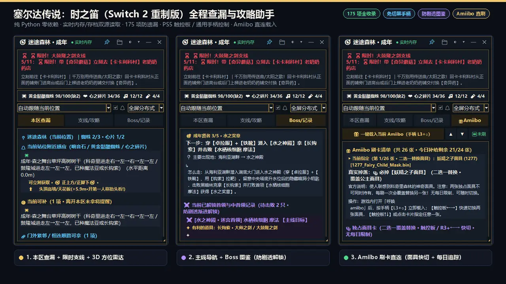
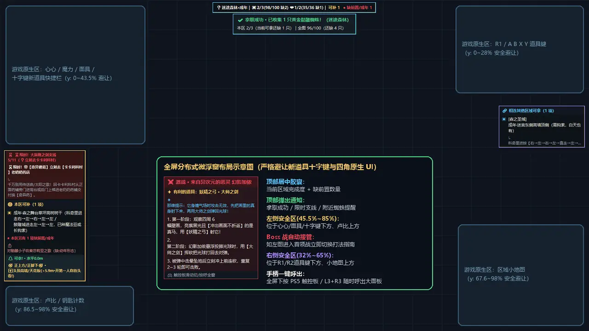

# 塞尔达传说：时之笛（Switch 2 重制版）全程查漏与攻略助手

> **纯 Python 零第三方依赖** · 实时内存 + 存档双源读取 · 175 项全收集防遗漏 · PS5 触控板 / 通用手柄免切屏操控 · 全屏原生 UI 安全区避让 · Amiibo 直连刷卡

<p align="center">
  
</p>

---

## ✨ 核心特性

- **开箱即用 `.exe` + 纯源码双支持**：[GitHub Releases](https://github.com/csszyft/oot-switch2-tracker/releases) 直接提供免安装 Python 的独立可执行文件；源码版亦仅依赖 Windows 自带 Python 3.10–3.13 标准库（`tkinter` + `ctypes` Win32 API），无需 `pip install`，不注入游戏进程、不抢夺游戏窗口焦点。
- **双源自动同步（实时内存 + 存档回退）**：毫秒级轮询 **NX2navi (`ocarina.exe`)**、**Fritchii / Lichii (`lichii.exe`)** 与 **Hookshot (`hookshot.exe`)** 实时内存，无需手动指定目录；未开兼容端或仅排查存档时，自动读取 **Eden / Yuzu / Citron / Suyu / Ryujinx** 存档槽位。实时结合 `Sequence_CurrentBanc` 与 `Sequence_ReservedBootEventName` 裁决位置，跨区传送过场不再滞留旧地名。
- **175 项全收集精准判定**：完整覆盖 **100 只黄金骷髅蜘蛛、36 块心之碎片、12 首时之笛乐曲、4 个空瓶**，附带 **37 个隐藏洞** 图鉴。结合当前时代（幼年/成年）与已获道具自动拆分为「**当前可补**」与「**缺前置/成年暂不可拿**」，离开区域仍有可补项时自动防漏提醒。
- **主线导航 + 大戈隆剑限时链 + 防剧透 Boss 图鉴**：主线进度条精确到当前精灵石/贤者奖章并附完整走法；大戈隆剑 11 步交易链在限时阶段自动红色高优先提醒；Boss/中Boss 攻略随推进渐进解锁，进入 Boss 房自动接管左侧栏、击败后基于 `IsBossBattle` 与演出旗标瞬时结束战斗并恢复查漏。
- **最终决战仪式感界面 & 娜薇（Navi）全分段彩蛋**：进入大魔王加侬多夫 / 高塔崩塌逃离 / 魔兽加侬（夺回大师之剑） / 终局胜利告别四阶段时，自动切换紫金/暗红/凯旋专属配色与全屏微浮窗样式，并以 Switch 2 官中官方译名「娜薇」的口吻弹出开局助威与终局告别彩蛋。
- **3D 方位与高低差雷达**：实时读取玩家 3D 坐标并计算水平距离与高度差，明确提示「正上方/头顶高墙（开第一人称抬头看）」「正下方/水底」及距离米数。
- **全屏分布式安全区微浮窗**：检测到游戏全屏时自动切换为顶部胶囊 + 左右安全区微浮窗 + 收集/附近 Toast，严格避开 Switch 2 版游戏四角原生 UI，且窗体鼠标完全穿透。
- **Amiibo 免菜单直连刷卡**：游戏进入「呼唤 Amiibo」界面时自动弹出选卡列表，内置 **2 张独占面具快切** 与 **24 张每日补给追踪**，直接向游戏传入 `.bin` 卡片数据。

---

## 🖥️ 界面说明

### 1. 桌面悬浮窗（窗口模式）

#### 顶部标题栏与功能按钮

| 元素 | 说明 |
| :--- | :--- |
| `📍 当前区域 · 时代` | 实时显示所处地图与当前形态（`幼年` / `成年`） |
| `● 实时内存 / 存档` | 当前数据源状态指示灯（绿灯为实时内存，蓝/灰为存档） |
| `🎮 手柄状态` | 显示已连接手柄类型（如 `PS5 DualSense` / `Xbox` / `通用手柄`） |
| `📌` | 切换窗口是否保持桌面置顶 |
| `📁` | **一键打开工具所在文件夹**（方便放置存档、Amiibo 或排查日志） |
| `◐` | 循环调节悬浮窗透明度 |
| `▾ / ▸`（`展开 / 收起`） | 折叠为精简条或展开全量卡片；**展开状态下同时完整展示当前主线走法** |
| `—` | **最小化到 Windows 任务栏**（最小化期间仍支持手柄一键唤醒） |
| `✕` | 安全关闭助手并释放手柄监听与窗口钩子 |

#### 顶部状态条与控制栏

- **紧急性提醒横幅**：触发大戈隆剑限时送药等任务时置于最顶层高亮提示。
- **全局进度总览**：实时统计 `🕷 黄金骷髅蜘蛛 X/100`、`❤ 心之碎片 X/36`、`🎵 乐曲 X/12`、`🫙 空瓶 X/4`。
- **区域切换与模式栏**：支持「自动跟随当前位置」或手动下拉查看全海拉鲁任意迷宫/地区；右侧开关控制是否启用声音提醒与「全屏分布式 / 全屏仅提示 / 全屏不隐藏」模式。

#### 四大功能分页

1. **`本区查漏`（默认主界面）**
   - **当前站位附近感应**：当靠近隐藏洞或未收集蜘蛛/心片时自动显示 3D 水平距离、高低差及获取方式；幼年走近软土坑时同步提示该坑是否需要种魔法豆。
   - **🌱 本区软土坑 · 魔法豆指引**：动态区分当前区域土坑为「🔴 必种魔法豆」「🟡 推荐顺手种（可用长钩索替代）」「✅ 不用种魔法豆（仅卢比/捷径或关联奖励已全拿）」。
   - **🟠 当前可补**：当前形态与道具已满足条件的遗漏项，离开该区域若仍未拿取将触发防漏提醒。
   - **🔴 差道具 / 成年或幼年可拿**：标注具体缺失前置（例如长钩索、魔法豆、幼年形态或特定乐曲），避免盲目跑图。
   - **🔗 门外紧邻 / 相连顺路可拿**：提示一步即可跨图顺手拿取的相邻区域收集品。
2. **`支线/攻略`**
   - 汇总当前阶段全部主线目标、多步贸易/收集支线（大戈隆剑、面具任务等）、隐藏洞穴清单与黄金蜘蛛奖励档位进度。
3. **`Boss/记录`**
   - 顶部保留完整主线导航与下一步路线，下方展示当前已解锁的迷宫 Boss / 中 Boss 打法与弱点道具，已击败首领自动折叠归档，未到达区域保持锁定防剧透。
4. **`🎁 Amiibo`（条件显示）**
   - 仅在游戏内打开「呼唤 Amiibo」时自动显示并切换（退出界面后自动隐藏）：
     - 高亮当前选中卡片及真实掉落说明，区分「**独占面具卡（二选一覆盖替换，无每日限制）**」与「**每日补给卡（已刷 / 未刷状态实时记录）**」。
     - 点击「一键载入当前 Amiibo」或直接按下手柄快捷键即可刷入游戏。

---

### 2. 全屏分布式安全区布局

当你在全屏游玩的显示器上打开游戏时，助手会自动收缩大窗体，拆分为四个**鼠标完全穿透**（`WS_EX_TRANSPARENT` + `WS_EX_NOACTIVATE`）的轻量微浮窗，严格避让 Switch 2 原生 UI 四角：

<p align="center">
  
</p>

| 浮窗位置 | 避让区域 | 显示内容 |
| :--- | :--- | :--- |
| **顶部居中胶囊** | 避开左上角心心/魔力与右上角 A/B/X/Y 键 | 当前位置、时代、全图/本区收集数与缺前置数 |
| **顶部居中 Toast** | 位于胶囊正下方 | 刚拿到的收集品播报、离区漏项提醒、附近隐藏洞/蜘蛛雷达 |
| **左侧中部微浮窗** | 严格位于心心/魔力/面具/新道具十字快捷栏下方（45.5%~85%）、卢比上方 | 平时展示本区可补 + 3D 方位提示；**进入 Boss 战自动切换为首领打法，击败后自动切回** |
| **右侧中部微浮窗** | 位于 R1/R2 道具栏下方（32%~65%）、小地图上方 | 相连周边区域当前顺路可拿的收集项 |

> 在全屏模式下随时按下 **PS5 触控板**（或非 PS5 手柄 **`L3 + R3`**），即可原地呼出完整大面板翻看攻略，再按一次立即收起回全屏微浮窗。

---

## 🎮 手柄与快捷键说明

所有快捷组合均**避开了 `Home` 键（防止触发 Windows Game Bar）、`+/-` 菜单键及 `L/R/ZL/ZR` 肩键**，确保游玩过程零误触。

### PS5 DualSense（原生 HID 触控板手势）

| 操作 | 普通模式 | 呼唤 Amiibo 时 |
| :--- | :--- | :--- |
| **按下触控板** | 全屏：呼出/收起大面板；窗口：展开/折叠（已最小化时自动还原） | 刷新/退出状态 |
| **触控板左右滑动** | 切换标签页（本区查漏 / 支线攻略 / Boss记录） | 快速切换两张独占面具（妖精之子 / 塞尔达公主） |
| **触控板上下滑动** | 1:1 丝滑滚动长列表 | 逐张上下选择 Amiibo 卡片 |
| **`L3 + ○`** | — | **一键将当前选中的 Amiibo 载入游戏** |

### Xbox / Switch Pro / 通用手柄（XInput + DirectInput）

| 操作 | 普通模式 | 呼唤 Amiibo 时 |
| :--- | :--- | :--- |
| **`L3 + R3`**（双摇杆同时按下） | 呼出/收起大面板（已最小化时自动还原） | — |
| **`R3 + 十字键 ← / →`** | 切换标签页（本区查漏 / 支线攻略 / Boss记录） | 快速切换两张独占面具 |
| **`R3 + 右摇杆 ↑ / ↓`**（推荐）或 `R3 + 十字键 ↑ / ↓` | 顺滑滚动列表（长按十字键自动连滚） | 按 `R3 + ↑ / ↓` 逐张选卡 |
| **`L3 + B`**（Xbox）/ **`L3 + A`**（Switch） | — | **一键将当前选中的 Amiibo 载入游戏** |

> **提示**：
> - 在 **NX2navi** 中，`L3 + R3` 同时也是其内置左上角 FPS 浮层的默认快捷键。
> - 使用 **Switch Pro** 原生蓝牙手柄时，建议配合 Steam 输入或 BetterJoy 转为 XInput，以获得最佳兼容与按键响应。

---

## 🔌 支持端与功能矩阵

| 运行环境 | 实时内存定位 & 3D 坐标 | 自动存档追踪 | Amiibo 直连刷卡 | 备注 |
| :--- | :---: | :---: | :---: | :--- |
| **NX2navi (`ocarina.exe`)** | ✅ 支持 | ✅ 自动识别 | ✅ 支持 | 全功能完整支持 |
| **Fritchii / Lichii (`lichii.exe`)** | ✅ 支持 | ✅ 自动识别 | ✅ 支持 | 全功能完整支持 |
| **Hookshot (`hookshot.exe`)** | ✅ 支持 | ✅ 自动识别 | ❌ 不支持 | 自动关联 `user/save` 与实时内存，无需手动填路径；端本身暂不支持 Amiibo |
| **Eden / Yuzu / Citron / Suyu** | — | ✅ 自动识别 | 📁 扫描本地目录 | 自动定位 `nand/user/save` |
| **Ryujinx** | — | ✅ 自动识别 | 📁 扫描本地目录 | 自动识别 `%APPDATA%\Ryujinx` |

---

## 🚀 快速开始

### 方式一：直接下载 Release 可运行文件（推荐，无需安装 Python）
1. 前往本仓库右侧 [**Releases 页面**](https://github.com/csszyft/oot-switch2-tracker/releases)，下载 `OoT-Switch2-Tracker-*.exe`（单文件直接双击运行）或 `OoT-Switch2-Tracker-*-Win64.zip`（解压后双击 `时之笛进度助手.exe`）。
2. 先开助手或先开游戏均可自动探测连接，支持传入 `--minimized` 静默最小化到任务栏启动。

### 方式二：从源码运行（Python 3.10 ~ 3.13 标准库）
1. 安装官方标准版 **Python 3.10 ~ 3.13**（[python.org](https://www.python.org/downloads/)），勾选 `Add Python to PATH` 与 `tcl/tk and IDLE`（无需任何 `pip` 第三方库）。
2. 克隆或下载源码后双击启动：
```bash
git clone https://github.com/csszyft/oot-switch2-tracker.git
cd oot-switch2-tracker
```
- **正常启动**：直接双击 **`启动时之笛助手.bat`**（无黑框后台运行）。
- **调试排错**：双击 **`启动时之笛助手_调试终端.bat`**（保留控制台窗口查看实时日志）。
- **静默最小化启动**：命令行传入 `--minimized` 启动，初始最小化在任务栏，进游戏后由手柄呼出：
  ```bash
  pythonw overlay_hud.py --minimized
  ```

### 3. 可选配置 (`tracker_config.json`)

默认留空即可自动扫描正在运行的游戏进程与常规目录；如需固定路径或关闭音效，可编辑根目录下的 `tracker_config.json`：

```json
{
  "save_dir": "",
  "amiibo_dir": "",
  "slot": "auto",
  "fs_mode": "distributed",
  "sound_enabled": true
}
```

- `save_dir`：留空自动探测，或手动填入具体存档目录（也可直接把 `slot_00` 等放进本目录下的 `saves/`）。
- `amiibo_dir`：留空自动探测，或填入 `.bin` 卡片所在文件夹（也可直接放进本目录下的 `amiibo/`）。
- `slot`：`auto`（自动跟踪最新保存槽位）或指定槽位名。
- `fs_mode`：`distributed`（全屏分布式避让微浮窗）、`toast_only`（全屏仅提示弹窗）或 `off`（全屏不隐藏）。

---

## 📁 文件结构

```text
oot-switch2-tracker/
├── 启动时之笛助手.bat            # 一键启动（无控制台黑框）
├── 启动时之笛助手_调试终端.bat    # 带日志终端启动
├── overlay_hud.py                # 桌面悬浮窗 + 全屏安全区分布式微浮窗主程序
├── tracker_engine.py             # 175 项判定引擎、主线/限时支线、Boss 图鉴与 3D 坐标计算
├── save_reader.py                # 实时内存读取 + 多模拟器存档自动发现
├── gamepad_ctrl.py               # DualSense 触控板 HID + XInput / DirectInput 快捷键监听
├── amiibo_helper.py              # Amiibo .bin 扫描、每日记录管理与直连刷卡
├── win_proc.py                   # Windows 进程探测工具
├── portable_config.py            # 便携配置文件读写
├── oot_world_db.json             # 175 项收集品 + 隐藏洞 + 区域哈希数据库
├── tracker_config.json           # 默认运行配置
├── amiibo_daily_log.json         # 每日 Amiibo 已刷记录（初始为空）
├── docs/                         # README 展示图与安全区布局图
├── saves/                        # 可选手动放置存档目录
└── amiibo/                       # 可选手动放置 Amiibo .bin 目录
```
